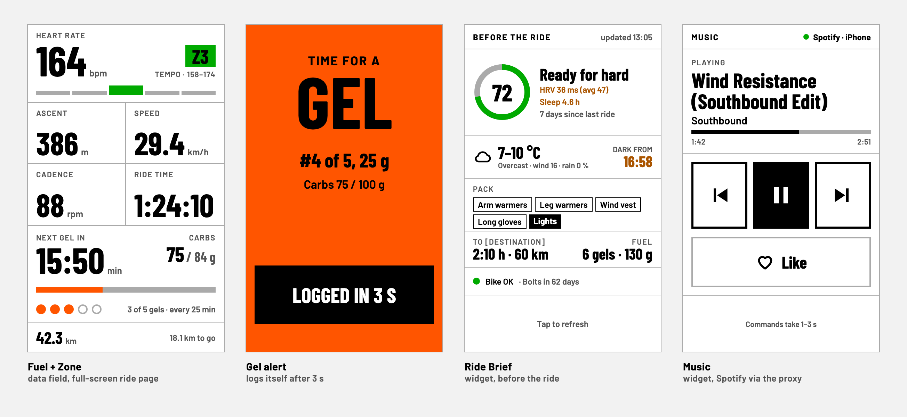

# edge-ciq

Connect IQ apps for the Garmin Edge 1030 Plus. Design (screens, layout spec):
the "Edge 1030 Plus Interface" canvas on claude.ai.



_Renders of the design canvas (282 x 470, the Edge 1030 Plus screen), with sample data. Single screens in [`docs/`](docs/)._

| App | Type | Status |
|---|---|---|
| `fuelzone/` | data field, full screen | ride screen, gel alert; on the Edge. Also an Edge 840 build, see below |
| `briefing/` | widget "Ride Brief" | on the Edge (enable it in the widget loop) |
| `music/` | widget "Music" | on the Edge (enable it in the widget loop) |
| `shared/` | code | `widget/` (proxy calls, drawing) for the widgets |

## fuelzone

One full-screen data field (put it on a 1-field data page):

- **Heart rate** with zone pill and 5-part zone bar. Zones are the device's
  cycling HR zones (set in Garmin Connect). The `hrZones` setting can
  override them with four upper limits, e.g. `120,150,165,180`. No zones
  known: no pill.
- **Ascent (or 3 s power), speed, cadence, ride time.** The first slot shows
  total ascent until a power meter sends data, then switches to 3 s power.
- **Fuel:** countdown to the next gel, carbs eaten and the current rate
  (g/h), dots per gel. Carbs build up as a need on timer time; a gel
  (`gelGrams`, 30) is due once the need since the last one reaches it. The
  rate is the higher of the ride-length rate and the HR-zone rate, capped
  at `maxCarbsPerHour` (90):
  - With a route: expected length = ride time + distance left at the
    average speed (past rides' average in the first 10 min). Under 1 h no
    gels, 1-2 h 30 g/h, 2 h+ 60 g/h (Jeukendrup 2014; 90 only through the
    zones, for hard riding). The first gel comes when the first 30 g are
    needed (30 min at 60 g/h). `plannedMinutes` counts like a route.
  - Without a route: first gel after `noRouteStartMin` (60), then 45 g/h.
  - Zones: Z3 at least 60 g/h, Z4 and Z5 90 g/h. Logic and its tests:
    `FuelState.mc`, `test/FuelStateTest.mc`.
- **Gel alert:** full-screen takeover plus a tone when a gel is due. Nothing
  to press: it counts down 5 s (the ride screen shows the seconds) and then
  logs the gel by itself, with a short confirmation tone.
- **Alert type:** Barlow Condensed (OFL, `fuelzone/fonts/src/`) as bitmap
  fonts per device, made by `scripts/fonts.py` (needs Pillow). Rerun it
  after changing sizes or the characters the alert draws.
- **FIT fields** `carbs` (g) and `gels` on the session, so they show on the
  ride in Garmin Connect.
- **Live ride:** every 30 s the field saves a snapshot (position, distance,
  ride time, HR and zone, gels, carbs, ascent, speed); a background sender
  (`LiveService`, 5 min minimum interval) posts the latest one through the phone
  to glance `/garmin-api/live`. glance alerts started / stopped 15+ min /
  finished in Telegram, claude-telegram reads it via `get_live_ride`. About
  60 KB per hour. Setting `liveTracking`.
- Gel state survives an app restart mid-ride (`Application.Storage`), and is
  cleared when the ride is saved or discarded.

**Edge 840 build** (for a friend): `DEVICE=edge840 scripts/build.sh fuelzone`
gives `bin/fuelzone-edge840.prg`. It has no live ride and no proxy secrets
in it (own resource path `settings/edge840/`). The heart rate
drops to a smaller font on the 246 x 322 screen. Install guide to pass on:
[`docs/edge840.md`](docs/edge840.md).

Settings (Garmin Connect app → device → Connect IQ apps → Fuel + Zone; sideloaded
apps may not show them, then change the defaults in `settings/own/properties.xml`):
`gelGrams`, `maxCarbsPerHour`, `noRouteStartMin`, `plannedGels`,
`plannedMinutes`, `hrZones`, `liveTracking` (not in the Edge 840 build).

## Widgets

Swipe down on the Edge to reach them. Sideloaded widgets start switched off:
enable them under Menu > Settings > System > Widgets. They call the glance proxy through
the phone (Garmin Connect app over Bluetooth, the phone's mobile data), so no
WiFi on the bike; without the phone the brief shows the last saved copy.

- **Ride Brief:** readiness ring and reasons, weather and dark-from, packing
  list, gel plan, bike status (`GET /garmin-api/edge-brief`). Tap refreshes.
- **Music:** Spotify previous / play-pause / next and like, straight to the
  Spotify Web API through the phone (`music/source/Spotify.mc`), no proxy.
  Polls `/me/player?market=from_token` every 5 s while shown (the market
  parameter drops the per-track country lists) and keeps only the fields
  it draws. Liked state and up next are asked once per track. Up next comes
  from the playlist (`/playlists/{id}/items`, song ids once to find the
  position, then ~120 bytes for the next song) or album, with shuffle off.
  Not from `/me/player/queue`: 35-50 KB, and the Edge rejects it (-402).
  With shuffle, radio or self-queued songs up next stays empty. On "next"
  the known next song shows at once; Spotify confirms after 0.5 s (retries
  while it still reports the old song). GETs carry a changing
  parameter: the iPhone's Garmin Connect app otherwise answered repeated
  requests from its cache (a song several skips old). No volume (the iPhone has
  no remote volume), no shuffle/repeat (Spotify disallows toggling them for
  this account). Needs Spotify Premium.

  Its own Spotify login, separate from glance's: add
  `http://127.0.0.1:8888/callback` as a redirect URI of the Spotify app
  (developer.spotify.com), then run `python3 scripts/spotify-login.py` once.
  It writes `secrets-spotify/spotify.xml` (gitignored): the app's Basic auth
  and a refresh token, baked into the build. The widget refreshes its access
  token hourly by itself. Revoke under spotify.com > Account > Apps.

The Ride Brief sends the narrow `EDGE_API_TOKEN` (only valid for its routes),
baked in at build time: `scripts/secrets.sh` writes it from `../glance/.env` (or
`$EDGE_API_TOKEN`) to the gitignored `secrets/edge.xml`. `scripts/build.sh`
runs it for the apps that use it automatically.

## Setup

1. Install the SDK Manager: `brew install --cask connectiq-sdk-manager`.
2. Open `SdkManager.app`, sign in with the Garmin account, install the latest
   SDK, click "Use this SDK", and under Devices install **Edge 1030 Plus**.
3. Signing key (once, kept out of git):

   ```bash
   openssl genrsa -out developer_key.pem 4096
   openssl pkcs8 -topk8 -inform PEM -outform DER -in developer_key.pem -out developer_key.der -nocrypt
   ```

Optional: the "Monkey C" VS Code extension for editing and debugging.

## Build, simulate, test

```bash
scripts/build.sh fuelzone   # bin/fuelzone.prg (also: music, briefing)
scripts/sim.sh fuelzone     # build + run in the simulator
scripts/test.sh fuelzone    # (:test) unit tests in the simulator
```

In the simulator: Simulation → Activity Data to feed HR/power/speed, and
Simulation → Data Fields → Layout 1 field for the full-screen layout.

## Install on the Edge

Plug the Edge in over USB and copy `bin/<app>.prg` to `GARMIN/Apps/` with
`cp -X` (macOS `._` files make the Edge log signature errors).
Unplug, then add the field to a data page of the ride profile.

Climbs: none here on purpose, Garmin's ClimbPro covers them on routes.
